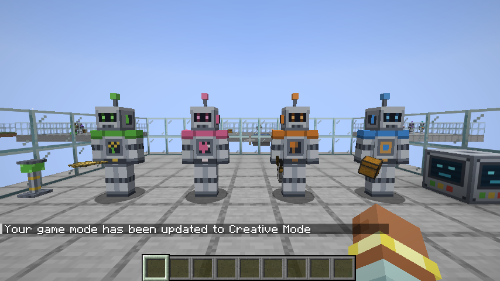
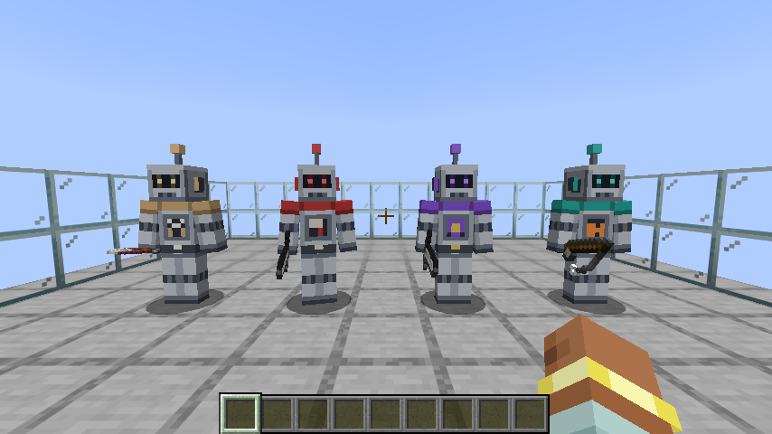
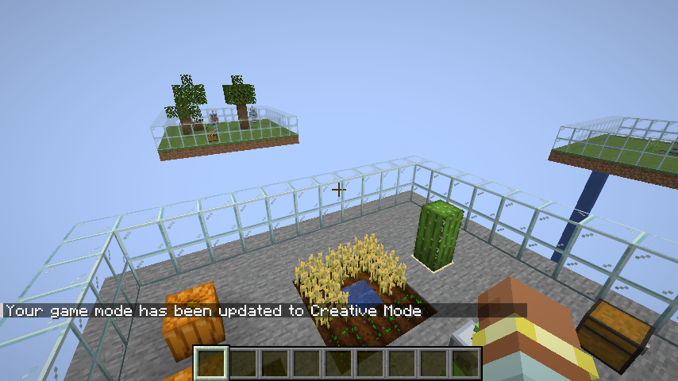
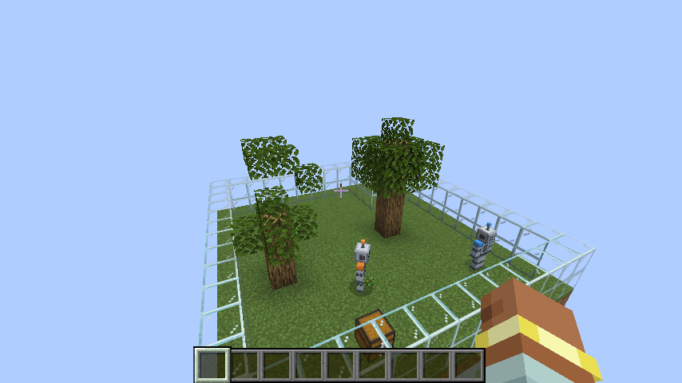
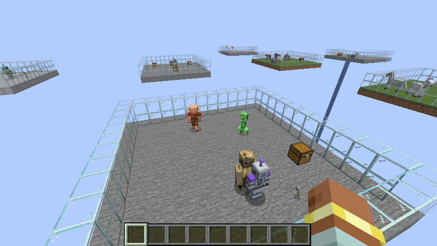
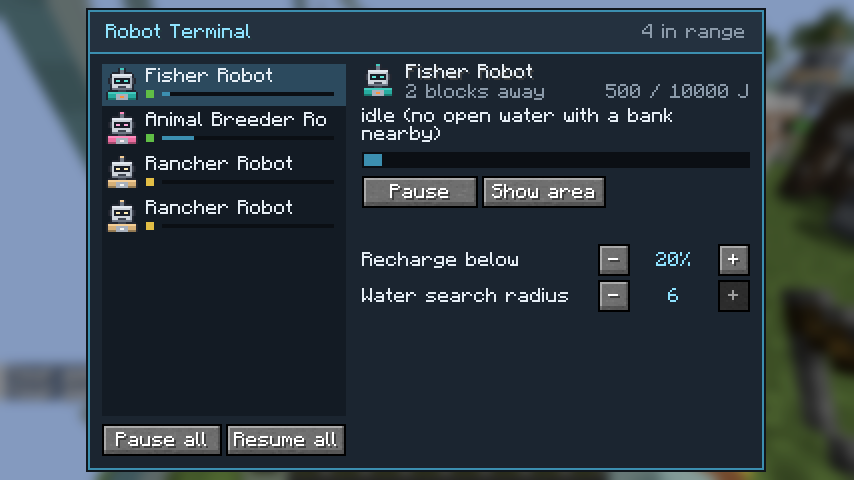
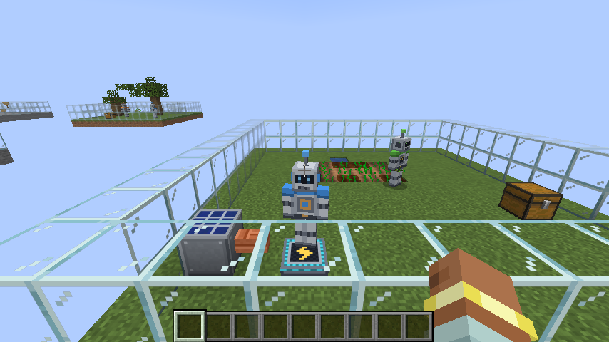
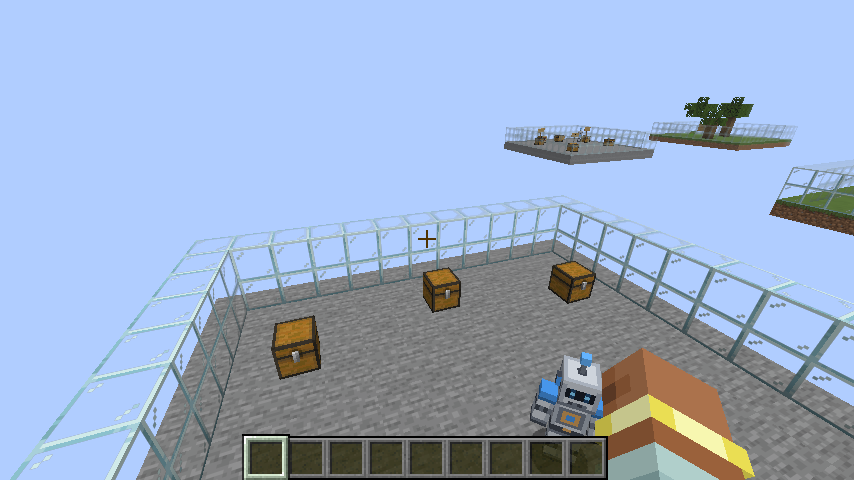

# CurseForge release kit (Voltworks Robots)

Everything needed to create the project and upload the first file. Copy the fields below into the CurseForge author console. Voltworks Industrial must already be on CurseForge, because this project lists it as a required dependency.

## Project settings

| Field | Value |
|---|---|
| Name | Voltworks Robots |
| Summary (one line) | Walking worker robots for Voltworks Industrial: they farm, breed, shear, cull, chop trees, fish, guard your base and sort your chests. |
| Game / type | Minecraft / Mods |
| Main category | Technology |
| Extra categories | Automation, Farming, Mobs, Addons |
| License | MIT License |
| Logo | `docs/images/logo.png` (400×400; regenerate with `java tools/GenIcon.java .`) |
| Screenshots (Images tab) | From `docs/images/`: `robots-lineup.png`, `robots-lineup-new.png`, `robots-farm.png`, `robots-lumberjack.png`, `robots-guard.png`, `robots-organizer.png`, `robots-terminal.png`, `robots-charging.png` |
| Source link | https://github.com/chrisbrady86/voltworks-robots |
| Issues link | https://github.com/chrisbrady86/voltworks-robots/issues |

The mod's in-game name is "Robots" (mod id `robots`). "Voltworks Robots" is the suggested project name because "Robots" alone is too generic to find and matches Voltworks Quarry.

**Categories.** CurseForge takes one main category and a few extras. If it only allows fewer than four extras, drop them from the end of the list: Automation and Farming matter most.

| Category | Why it fits |
|---|---|
| Technology (main) | Powered machines on the Voltworks energy grid |
| Automation (under Technology) | Every robot automates a job |
| Farming (under Technology) | Farm, Breeder, Rancher, Butcher, Lumberjack and Fisher robots |
| Mobs | The robots are walking entities, not blocks |
| Addons | It is an expansion for Voltworks Industrial |

Categories that do not fit: Energy (it uses power but adds no generation or transport), Storage (the Organizer sorts chests but adds no storage), Food.

**If you also publish on Modrinth:** categories Technology, Utility, Mobs; environment client and server, both required; the same summary and description work there.

## First file upload

| Field | Value |
|---|---|
| File | `build/libs/robots-0.3.1.jar` (not the `-sources` jar) |
| Display name | Voltworks Robots 0.3.1 |
| Release type | Beta |
| Game version | 26.3 |
| Mod loader | Fabric |
| Java version | Java 25 |
| Environment | Client and Server |
| Related projects | **Voltworks Industrial** — Required Dependency · **Fabric API** — Required Dependency |
| Changelog | See below |

### Changelog for 0.3.1

```
First public release. Requires Voltworks Industrial.
- Eight walking worker robots: Farm, Animal Breeder, Rancher, Butcher, Lumberjack, Fisher, Guard and Organizer
- Each robot has a home, a 9-slot inventory and an owner; only the owner can open, change or pick it up
- Field Markers: mark a field, pen or tree farm for a robot to work in
- Robot Terminal: every robot in range with status, pause buttons and per-robot settings
- Robot Charging Pad: robots walk over and recharge from Voltworks power; Power Cells charge them by hand
- Organizer Robot sorts an input chest into chests labelled with signs or item frames
- Robots leave pets, named and tamed animals, log buildings, locked chests and unopened loot chests alone
- Adds Robots pages to the Voltworks Guide
- Server limits in config/robots.properties
```

## Project description (paste into the description editor, Markdown mode)

The pictures are linked from this repo on GitHub, so the text can be pasted as it is.

```markdown
# Voltworks Robots

**An expansion for [Voltworks Industrial](https://www.curseforge.com/minecraft/mc-mods/voltworks-industrial).** Build walking worker robots, give each one a home and a job, and let them run the farm, the pens and the storage room while you get on with building.



## 🤖 How robots work
- **Place one** by using its item on a block. That spot is its **home**: it works in the area around it and comes back when idle.
- **You own it.** Only you can open it, change it or pick it up.
- Each robot has a **9-slot inventory** and carries what it collects to the **nearest chest**.
- **Punch it** to ask what it is doing and what is holding it up ("needs seeds", "no chest with room nearby").
- **Sneak + right-click** pauses it. **Sneak + punch** picks it up with its energy, settings and name.
- Robots can't be hurt, don't trample farmland and don't wander off through portals.

## 👷 The robots
| Robot | Job |
|---|---|
| Farm | Harvests and replants crops; cuts pumpkins, melons, sugar cane, cactus and nether wart. With a hoe and seeds it tills and plants a marked field. |
| Animal Breeder | Feeds pairs of animals with food from a chest, up to a set number per kind. |
| Rancher | Shears sheep and gathers wool, eggs, feathers and leather. |
| Butcher | Keeps each kind of animal at a set number and collects the meat. Never touches babies, pets, or named, tamed or saddled animals. |
| Lumberjack | Fells trees from the top down, replants saplings and brings the wood home. Leaves log buildings alone. |
| Fisher | Fishes from the bank of open water and stores the catch. |
| Guard | Fights hostile mobs around its home and collects their drops. Leaves named mobs alone; creepers can be switched off. |
| Organizer | Sorts an input chest into the chests around it. |









## 📍 Marking an area
Stand a **Field Marker** next to a robot's home and another at the opposite corner. The robot takes both and works only that rectangle: a field for the Farm Robot, a pen for the Breeder, Rancher and Butcher, a tree farm for the Lumberjack. Only markers you placed yourself count.

## 🖥️ Robot Terminal
One screen for every robot in range: a state light, an energy bar, what each one is doing, **Pause all / Resume all**, and **settings per robot** such as work radius, animals kept, which animals to handle and when to recharge.



## ⚡ Power
Robots run on Voltworks energy. Right-click one with a **Power Cell** to charge it by hand, or wire a **Robot Charging Pad** to your power grid: a robot that runs low walks to the pad and fills up by itself.



## 🗃️ Sorting chests
The **Organizer Robot** empties an input chest into the others nearby. Put a **sign** on a chest to say what belongs in it (`ores`, `logs`, `food`, `@voltworks`, `misc`), or an **item frame** to name one exact item. Without labels it puts each stack where that item already is.



## 📖 Fits right in
The robots add their own pages to the **Voltworks Guide**. Server owners can set every range, speed and energy cost in `config/robots.properties`, and those values are also the most a player can choose at a terminal.

## Requirements
- Minecraft 26.3, Fabric Loader
- [Voltworks Industrial](https://www.curseforge.com/minecraft/mc-mods/voltworks-industrial)
- [Fabric API](https://www.curseforge.com/minecraft/mc-mods/fabric-api)

Needed on both the server and the client. Robots only work while their chunks are loaded. Modpacks: yes, go ahead! Voltworks Robots is MIT licensed.
```

## Before you click upload

- [x] Logo: `docs/images/logo.png`
- [ ] Publish Voltworks Industrial first, and check its CurseForge link above matches its real project URL
- [ ] Take the jar from `build/libs/robots-0.3.1.jar`
- [ ] The screenshots in `docs/images/` come from the automated test (854×480, a test platform in the sky, some with a chat line showing). Retake any you want to look better in a real world
- [ ] Test the jar once in a normal Minecraft install (Fabric Loader + Fabric API + Voltworks Industrial) to be sure it loads outside the dev environment
